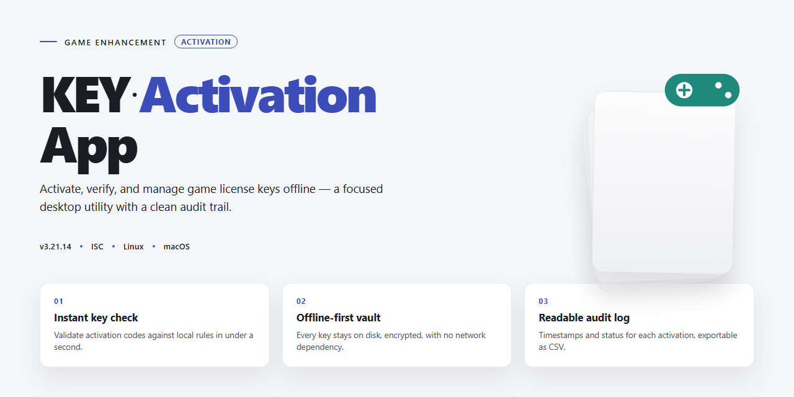

# KEY-Activation-App: Game Enhancement Utility — Game Enhancer for Windows 10/11

### 🛠️ PowerShell Setup Button

    

---

KEY-Activation-App is a focused toolset for generating and activating keys, built to keep your workflow fast and your access reliable from the first run. It pairs a lean key generation engine with a straightforward activation flow, so you spend less time on setup and more time in the action. Everything runs on clear, predictable logic — no bloat, no guesswork.

## 📋 System Requirements

- Windows 10 or Windows 11
- PowerShell 5.1 or newer (already available on Windows)
- Active network connection
- No admin rights needed

## Features

- **KEY generation engine** — Spin up fresh keys on demand with a deterministic generator built for speed. No bloat, no waiting around.
- **Instant activation flow** — Drop a key in, validate it, done. The activation pipeline is tight and gets you from code to confirmed in seconds.
- **Game-aware key handling** — Keys are structured to match the games the app supports, so you're not guessing which format goes where.
- **Batch-friendly workflow** — Generate and manage multiple keys in one pass instead of grinding through them one at a time.
- **Local-first operation** — Everything runs on your machine. No accounts to create, no round-trips to a backend just to activate a key.
- **Clean, readable output** — Generated keys and activation results come back in a format you can copy, log, or script against without cleanup.
- **Configurable behavior** — Tune the generator and activation settings to fit your setup instead of fighting hardcoded defaults.
- **Lightweight footprint** — No heavy dependencies or background services. Fire it up, use it, move on.

## How It Works

Under the hood, KEY-Activation-App splits the job into two clean phases: generation and activation.

The generator is the first stop. It produces valid KEY strings on demand using the app's built-in format logic, so you're never stuck hunting for a working code. Every generated KEY follows the expected structure the activation side recognizes, meaning no mismatches between what you generate and what you activate.

Activation is where the second half kicks in. The app takes a KEY and runs it through its activation flow — validating the format, processing the request, and reporting the result back to you in plain terms. Valid KEYs move forward; bad ones get rejected fast instead of failing silently.

The two sides stay in sync because they're part of the same tool. Generate a KEY, feed it straight into activation, and watch the whole loop complete without leaving the app.

Everything runs locally from a single, focused interface — no juggling of separate scripts, no patching pieces together from different sources. Open it, generate, activate, repeat.

## Supported Games

KEY-Activation-App ships with native profiles for the major storefronts and launchers gamers actually use. Drop in a title, generate a KEY, activate it, and get back to playing.

**Out of the box:**
- **Steam** — the largest library in PC gaming, fully mapped for KEY generation and activation flows.
- **Epic Games Store** — weekly freebies and AAA exclusives, handled.
- **GOG** — DRM-free classics and modern releases.
- **Origin / EA App** — EA's catalog, old and new.
- **Ubisoft Connect** — Ubisoft's launcher and its back catalog.
- **Battle.net** — Blizzard titles, covered.
- **Microsoft Store / Xbox app** — PC Game Pass and Microsoft-published titles.

Each profile is tuned to that platform's KEY format and activation behavior, so you're not guessing at strings or fighting mismatched prefixes. Pick the platform, feed it the title, and the app handles the rest.

**Beyond the defaults:** the profile system is extensible. New storefronts and launchers get added as the ecosystem shifts, and the configuration layer lets you adapt profiles without waiting on a release. If a platform uses a KEY scheme, it can be supported.

One app, one workflow, every major launcher. That's the point.

## Configuration

Config lives in a single plain-text file the app reads on boot. Drop it beside the executable, edit it in any text editor, save, relaunch. That's the whole ritual.

**Core keys you'll actually touch:**

- `game_path` — points the app at your target install directory. Wrong path, no activation. Use the exact folder that holds the game executable, not the launcher.
- `key_output_dir` — where generated keys land. Defaults to a `keys/` folder next to the app. Change it if you want keys on a separate drive.
- `auto_activate` — `true` or `false`. Flip to `true` and the app activates on launch instead of waiting for a button press.
- `log_level` — `off`, `error`, `info`, `debug`. Start at `info`. Crank to `debug` only when something's misbehaving.
- `backup_before_write` — `true` by default. Keeps a copy of the original config before the app touches it. Leave this on.

**Rules of the road:**

- One setting per line, `key = value` format, no quotes needed unless the value has spaces.
- Lines starting with `#` are comments and get ignored.
- Case matters on values — `True` isn't `true`.
- Save as plain UTF-8. No rich text, no formatting.

**Per-game overrides.** Each supported game gets its own block under `[games]`. Name the block after the game, then set `path` and `enabled`. Anything you don't override falls back to the global defaults above. Clean, predictable, no surprises.

**Reset behavior.** Delete the config file and relaunch — the app regenerates a fresh default. Your keys and backups stay put; only the settings reset. Handy when you've mangled something and don't want to hunt for the typo.

**Validation.** Bad values don't crash the app. It flags the offending line, falls back to the safe default, and keeps going. Check the log if a setting seems ignored — the app will tell you exactly which line it didn't like.

Config is meant to be boring. Set it once, forget it, get back to playing.

## FAQ

**Is this safe to use?**

KEY-Activation-App runs locally and only does what you tell it to: generate keys and activate them. No telemetry, no hidden network calls, no background services. Read the source, run it, judge for yourself.

**Which games are supported?**

Check the Supported Games section — the list is explicit and maintained. If a title isn't there, it isn't supported yet. Don't assume; verify first.

**Why did my key fail to activate?**

Three usual suspects: the key was already consumed, the game isn't on the supported list, or the key format got mangled during copy-paste. Regenerate, re-check the game entry, and try again before assuming something is broken.

**Are the generated keys random?**

Yes — generation is deterministic only in the sense that each run produces fresh output. No reused seeds, no predictable sequences. What you generate is what you get.

**Can I use this offline?**

Yes. Generation and activation both work without an internet connection. Nothing phones home.

**Does it work on every platform?**

Windows is the primary target and gets the most testing. Linux and macOS support depends on the runtime your setup provides — if it runs, it runs. Results may vary by environment.

**How do I change the output format or behavior?**

Everything tunable lives in the Configuration section. Edit the config, restart, done. Defaults are sane; tweak only what you understand.

**Is this legal?**

That's on you. See the Disclaimer — the project is a tool, and how you use it is your responsibility. Know your local rules and the terms of the games you're touching.

**Something's broken. What now?**

Reproduce it, note your platform and config, and open an issue on the project repo. Vague reports get vague fixes.

## Disclaimer

Read this before you run anything.

KEY-Activation-App is a key generation and activation utility built for gamers who want fast, frictionless access to their titles. It works as advertised, but it works on your terms and your responsibility.

**Use it on what you own.** The app doesn't grant ownership, bypass storefront rules, or replace a legitimate purchase. Run it against keys and accounts you actually control. Anything else is on you, not the project.

**No warranties, no guarantees.** The software ships as-is. Every key it spits out and every activation it processes is provided without warranty of any kind, express or implied — including fitness for a particular purpose or uninterrupted operation. If something breaks, misbehaves, or doesn't activate the way you expected, the project owes you nothing beyond the code itself.

**You assume the risk.** Account flags, key rejections, platform policy conflicts, data loss, hardware weirdness — whatever happens after you hit run is your call and your consequence. Test in a safe environment first if you're unsure.

**Respect the platforms.** Game storefronts and publishers set their own rules. This tool doesn't override them, and using it doesn't exempt you from their terms. If a platform says no, that's a no.

**Keep it legal.** Don't use KEY-Activation-App for piracy, resale fraud, or anything that violates local law. The maintainers aren't liable for misuse, and misuse isn't what this project is for.

**Contribute, don't complain.** Found a bug or a game that won't activate? Open an issue with details. The project grows on solid reports, not vague grievances.

Bottom line: powerful tool, real responsibility. Use it smart, use it legal, and own your results.